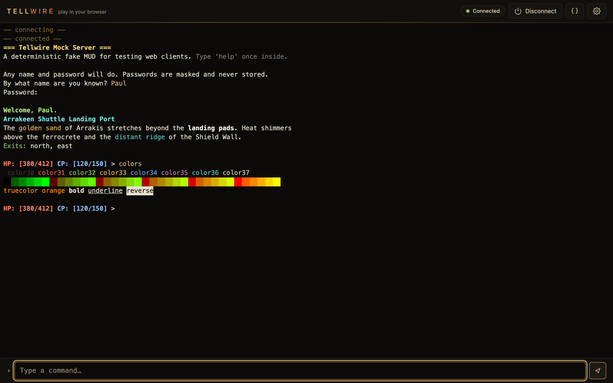
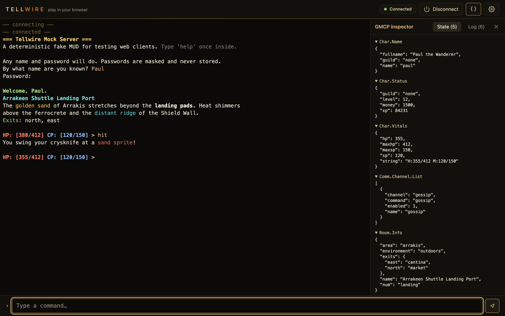
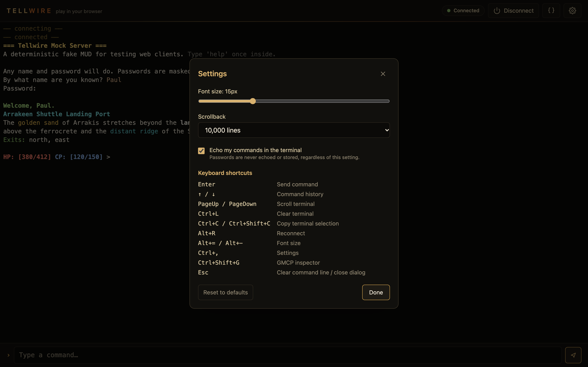
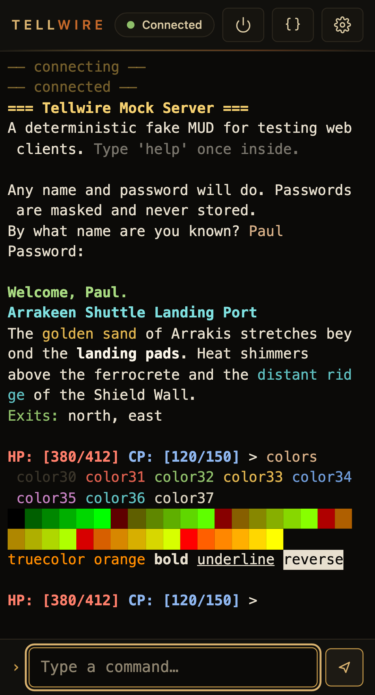

<div align="center">

# Tellwire

**Play any MUD in your browser. No client to install.**

A browser-based MUD client and a secure WebSocket-to-Telnet gateway, in one repo.

[](https://github.com/espiegel/tellwire/actions/workflows/ci.yml)
[](LICENSE)




</div>

> **Unofficial.** Tellwire is a player-built project made for [DuneMUD](https://dunemud.net). It is not
> affiliated with, endorsed by, or operated by DuneMUD or its administrators, and has no connection to the
> Dune franchise or its rights holders. The code is generic: the upstream MUD is just configuration.

## Why

Browsers can't open raw Telnet sockets, and classic MUD clients need an install. Tellwire closes that
gap: a small Go gateway speaks Telnet (or TLS Telnet) to the game, and a React + [xterm.js](https://xtermjs.org)
page speaks WebSocket to the gateway. Players open a URL and play.

## Features

- **Full terminal rendering** with ANSI, 256-colour and UTF-8, via xterm.js.
- **Real Telnet negotiation** on the gateway: TTYPE/MTTS, NAWS (window size follows the browser), ECHO, SGA, EOR and GMCP.
- **GMCP aware:** a generic GMCP store merges delta updates, and a built-in inspector shows live structured data (`Room.Info`, `Char.Vitals`, ...).
- **Safe password entry:** input is masked when the server sends `WILL ECHO` (with a prompt-text fallback). Masked text is never echoed, stored or put in history.
- **Command history, settings and a mobile layout**, with a dedicated input field.
- **Brandable per MUD:** drop in a `brand.json` to change the name, tagline and page title, with no rebuild (see [Branding](docs/deployment.md#branding)).
- **Hardened gateway:** fixed upstream allowlist, strict `Origin` check, always-verified upstream TLS, per-IP and global connection limits, bounded queues, timeouts and input rate limiting. Terminal text and input are never logged.
- **Small ops surface:** one static Go binary, `/healthz`, `/readyz`, `/metrics` (Prometheus text), and Docker Compose files for a demo and for production behind Caddy with automatic HTTPS.

<table>
  <tr>
    <td width="50%"></td>
    <td width="25%"></td>
    <td width="25%"></td>
  </tr>
  <tr>
    <td align="center"><sub>GMCP inspector</sub></td>
    <td align="center"><sub>Settings</sub></td>
    <td align="center"><sub>Mobile</sub></td>
  </tr>
</table>

## Quick start

Try it against the bundled mock MUD. Nothing leaves your machine.

**With Docker**

```bash
git clone https://github.com/espiegel/tellwire.git && cd tellwire
docker compose up --build        # then open http://localhost:8080
```

Log in with any name and password. Type `help` in the mock for its commands.

**Without Docker** (Go 1.24+ and Node 22+)

```bash
cd gateway  && go run ./cmd/mockmud &                                   # mock MUD on :2323
cd gateway  && GATEWAY_ALLOWED_ORIGINS=http://localhost:5173 \
               GATEWAY_UPSTREAMS=default=127.0.0.1:2323:plain go run ./cmd/gateway &
cd frontend && npm install && npm run dev                               # http://localhost:5173
```

## Point it at your MUD

The gateway is configured entirely by environment variables. Only `GATEWAY_ALLOWED_ORIGINS` is required.

| Variable | Default | Meaning |
|---|---|---|
| `GATEWAY_UPSTREAMS` | see `gateway/.env.example` | `name=host:port:tls\|plain`, comma separated. Browsers can only pick a profile name, never an address. |
| `GATEWAY_ALLOWED_ORIGINS` | *(required)* | Exact origins allowed to open a WebSocket. No wildcards. |
| `GATEWAY_MAX_CONNECTIONS` / `_PER_IP` | `500` / `10` | Configured limits, not measured capacity. |
| `GATEWAY_GMCP_SUPPORTS` | `Char 1,Room 1,Comm.Channel 1` | Modules requested with `Core.Supports.Set`. |
| `GATEWAY_CLIENT_NAME` | `Tellwire` | Sent as the terminal type and in `Core.Hello`. |

Every setting, with defaults, is in [`gateway/.env.example`](gateway/.env.example). To deploy behind
HTTPS, see [`docs/deployment.md`](docs/deployment.md).

## How it works

```
Browser (React + xterm.js)  ⇄  WSS /ws  ⇄  Caddy  ⇄  Go gateway  ⇄  (TLS) Telnet  ⇄  your MUD
```

The gateway runs one set of goroutines per session: an incremental Telnet parser, RFC 1143-style option
negotiation, a generic GMCP parser, and a bridge with a bounded queue and write, idle and dial timeouts.
The browser speaks a small protocol over the `tellwire.v1` WebSocket subprotocol: binary frames for terminal
output and JSON text frames for control messages.

- Wire protocol: [`docs/protocol.md`](docs/protocol.md)
- Design and threat model: [`docs/architecture.md`](docs/architecture.md)
- Notes on the DuneMUD server: [`docs/upstream-notes.md`](docs/upstream-notes.md)

## Repository layout

| Path | What |
|---|---|
| `gateway/` | Go gateway: Telnet/GMCP engine, WebSocket server, mock MUD, tests |
| `frontend/` | Vite + React + TypeScript + Tailwind + xterm.js, unit tests, Playwright e2e |
| `deploy/` | Compose files (demo and production), Caddyfiles, edge e2e script |
| `docs/` | Architecture, protocol, deployment and development guides |

## Development

```bash
make test        # go vet + go test -race, frontend typecheck + unit tests
make e2e         # real Chromium through the real gateway to the mock MUD
make demo        # docker compose up --build
```

See [`docs/development.md`](docs/development.md) and [`CONTRIBUTING.md`](CONTRIBUTING.md). Report vulnerabilities per [`SECURITY.md`](SECURITY.md). CI runs the same checks on every push and pull request.

## Status and limitations

Tellwire works and the maintainer plays on it, but it is early software. Please read this before relying on it.

- **Automated tests use a mock MUD only.** The maintainer has exercised the client against the real DuneMUD
  server by hand and it worked, but no automated test contacts it. An opt-in probe exists:
  `TELLWIRE_LIVE=1 go test -v -run TestLive ./gateway/internal/live/`.
- **No performance claims.** The 500-connection figure is a configured limit. There is no load test or
  benchmark yet, so memory, CPU and latency are unmeasured.
- **MCCP compression is not implemented** (the option is refused). Input is a single-line field, so a
  multi-line paste sends each line as a command.
- **No GMCP dashboard yet.** Only the generic GMCP store and the inspector exist.
- Charset is UTF-8 only. The terminal uses xterm's DOM renderer (no WebGL).

## Contributing

Issues and pull requests are welcome. Run `make test` and `make e2e` before opening a PR, and keep the
gateway's rules intact: no logging of terminal content or input, upstream TLS always verified, no
wildcard origins. If you run Tellwire for another MUD, please open an issue and say how it went.

## License

[MIT](LICENSE). Tellwire is an independent project and is not licensed by, or a product of, DuneMUD or the Dune franchise.
